# 空间办公 Spatial Office

在 PICO 头显里直接打开、编辑、保存标准的 .docx / .xlsx / .pptx 文件（另有 .md / .txt / .csv；PDF、图片、网页只读）。文档、表格、演示各开一扇原生窗口，配蓝牙键鼠使用；保存回去仍是标准格式，只改动过的地方，其余内容逐字节保留。表格里的图表可以立成 3D 图表，演示可以在空间里铺开、预演。当前版本 **v0.2.7**。

*English below.*

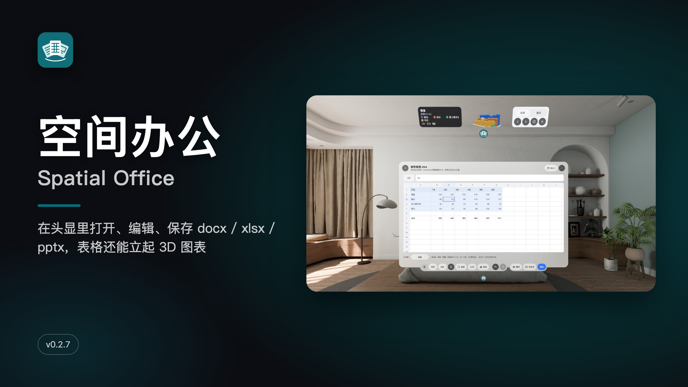

| | |
|---|---|
| 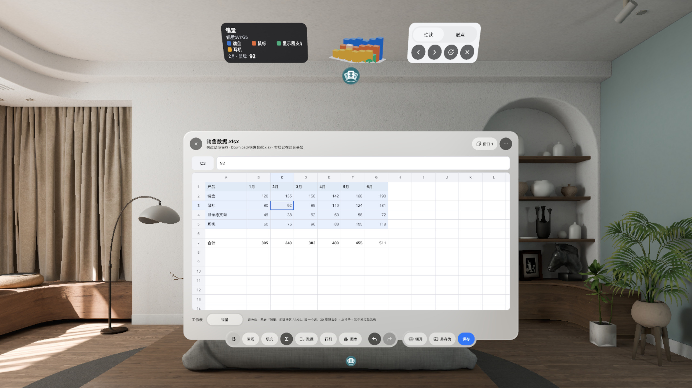 | 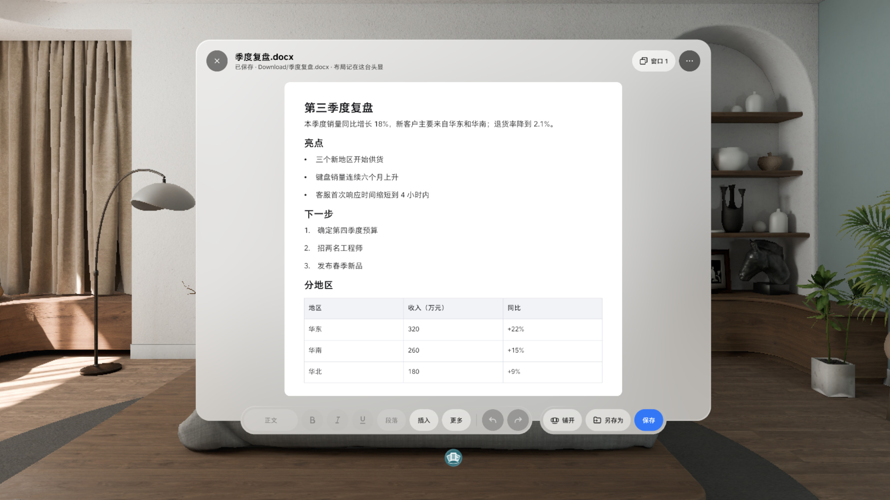 |
| 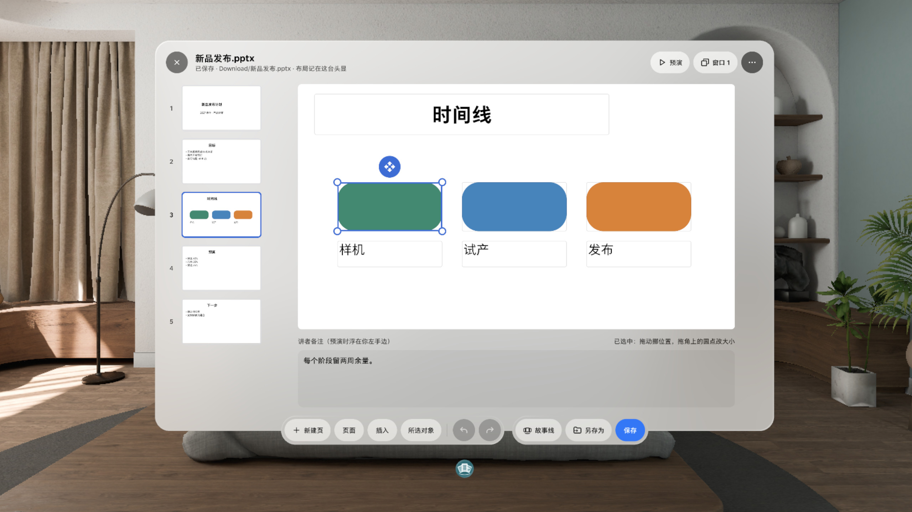 |  |
| 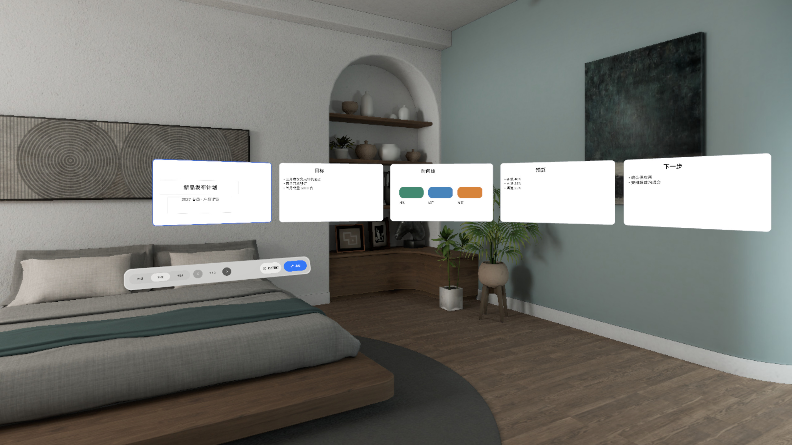 | 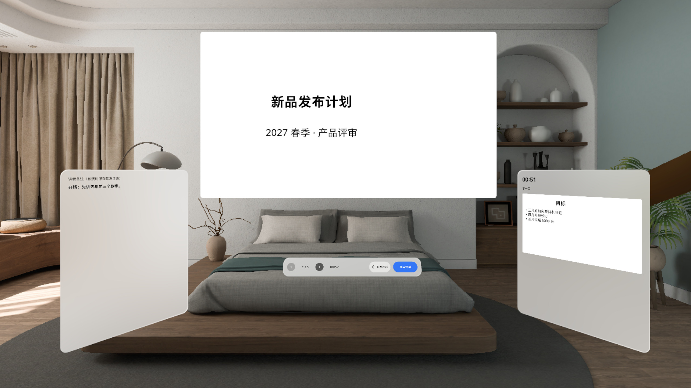 |

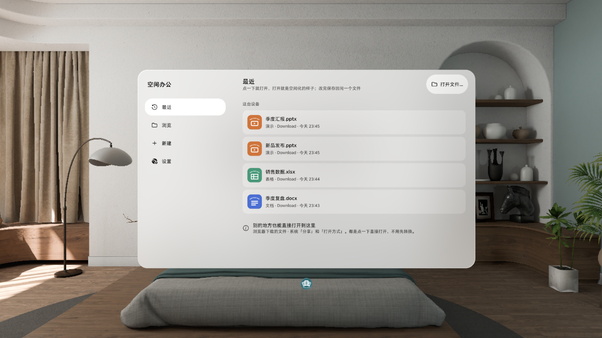

截图来自 PICO 模拟器（v0.2.7，调试指令驱动），**不是真实手势录像**；演示视频同样由模拟器调试指令驱动、没有声音。

## 能做什么

- **文档**：标题 / 正文 / 列表、对齐、删除线、图片、表格（都能拖角改大小）、查找替换、字数统计
- **表格**：45 个常用函数、数字和日期格式、填充色、排序筛选、冻结首行、插入 / 删除行列、柱状 / 折线 / 饼图
- **演示**：新建页（标题 / 正文 / 两栏 / 空白）、文本框、形状、图片、表格、主题配色、拖动排序；插入的东西点一下选中，按住拖动挪位置，拖四个角上的圆点改大小
- **同时开几个文件**：每个文件一扇窗，开第二个不会顶掉第一个；标题栏 [窗口 n] 里切换、回主页、并排摆开
- **3D 图表**：选中表格里的数据，[图表] › [3D 图表]，图表悬在表格窗口上方，改一个数柱子跟着变，可切柱状 / 散点、左右转
- **铺开 / 预演**：把一份演示的每一页并排、环绕或分层摆开；预演有大屏、讲稿和计时
- **保存**：第一次保存先备份原件（「名字（原件）」）；另存为副本 / PDF / CSV / TXT / 每页 PNG
- 射线、眼手、键鼠都能用；中英双语

## 安装

```
adb install -r SpatialOffice-v0.2.7.apk
pico-cli app launch io.embodit.spatialoffice
```

Release 里的 APK 是 `assembleRelease` 出的**未签名**包（给 Vibe Lab 平台托管签名用），本机直接装需要先自己签名，或用 `./gradlew :app:assembleDebug` 出 debug 包。构建、目录结构、调试广播见 [AGENTS.md](AGENTS.md)。

## 已知问题（v0.2.7）

- 这一版的安装包里**没有放任何云盘的应用 ID**，所以应用里不出现「账号与云盘」和云盘位置；放了 ID 再打包才有（见下「连接账号」）。真实云账号的登录、浏览、保存都**没有验证**，只有单元测试核过请求和应答格式
- 同时开几个文件时，新窗口开在正前方，先开的窗口被系统收到它后面（看不见）。系统没有「错开叠放」这种摆法：重叠着摆窗口不显示，并排摆又大半在视野外。用标题栏 [窗口 n] 切换；想同时看就点里面的 [并排摆开]，或捏住窗口下面的小圆点挪开
- 3D 图表属于打开它的那张表格；把另一张表格叫到前面时图表会收起
- 挪动、缩放插入的东西在模拟器上用真实指针拖过；手势、手柄射线、眼手三种输入在头显上还没有逐项验过
- 3D 图表在高负载的模拟器上打开要 1–3 秒，打开那一下最长一帧约 0.3–0.5 秒（v0.2.4 起不再卡住或弹「没有响应」；机器空闲时的数值没测到）
- 「系统窗口列表里还留着已销毁的旧窗口」时图表跳过它、挂到当前表格上：图表这条路仍只有单元测试覆盖（v0.2.5 并排摆开文档时，同一条规则在模拟器上跳过了一个已销毁的旧文档窗口）
- 演示窗口按页面比例留出备注区（v0.2.6）在模拟器上用 4:3、16:9、16:10、竖版四种文件看过；头显上还没看
- 中文输入法要先点一下表格单元格，候选才能上屏
- 演示视频没有声音，是模拟器调试指令驱动的，非真实手势录像

## 连接账号（飞书、Google Drive、OneDrive、Dropbox）

账号是可选的：一个都不连，本机文件全部能用。

**应用里只出现放了应用 ID 的那几家。** 打包时没放 ID 的服务，在「账号与云盘」「浏览」「怎么操作」里都不出现，也不会发出任何请求；四家都没放，「账号与云盘」这一页、「最近」里的云端分组和 [另存为] 里的云盘那一行都不显示。放了 ID 的服务显示 [连接]：**点一下直接弹出系统浏览器**，打开那一家自己的登录页（授权码 + PKCE），登录同意后浏览器自动跳回应用，全程不在应用里输密码。设备上没有浏览器时，飞书和 OneDrive 会改用扫码（设备授权码 RFC 8628：头显上只显示二维码和一组代码，在手机或电脑上同意）。

**怎么放 ID（给打包的人看）**：先到那一家的开发者后台登记一个应用（下表），然后二选一：

- 打包命令带上：`./gradlew :app:assembleDebug -Pcloud.feishu.appId=cli_xxx -Pcloud.feishu.appSecret=yyy`
- 或写进工程根目录的 `local.properties`（这个文件不进 git）：`cloud.feishu.appId=cli_xxx`

| 服务 | 去哪登记 | 应用类型 / 要开的权限 | 回调地址（登记时填，和下面的键一致） | 填进 local.properties |
|---|---|---|---|---|
| 飞书 | [飞书开放平台](https://open.feishu.cn/app) → 创建企业自建应用 → 安全设置 → 重定向 URL | 网页应用；权限：云空间 `drive:drive`、云文档 `docx:document`、电子表格 `sheets:spreadsheet`、`offline_access`（用户身份）；发布版本后企业内可用 | `http://127.0.0.1:53682/callback` | `cloud.feishu.appId=cli_xxx`<br>`cloud.feishu.appSecret=xxx` |
| Google Drive | [Google Cloud Console](https://console.cloud.google.com/apis/credentials) → 新建项目 → 启用 Google Drive API → OAuth 同意屏幕（测试用户里加上自己）→ 凭据 → OAuth 客户端 ID | 类型选「桌面应用」（Desktop app）；范围 `https://www.googleapis.com/auth/drive` | 桌面应用不用填，Google 允许 `http://127.0.0.1:<端口>` 回环地址；应用用 `http://127.0.0.1:53682/callback` | `cloud.google.clientId=xxx.apps.googleusercontent.com`<br>`cloud.google.clientSecret=xxx` |
| OneDrive | [Azure 门户 · 应用注册](https://portal.azure.com/#view/Microsoft_AAD_RegisteredApps/ApplicationsListBlade) → 新注册 → 受支持的帐户类型选「任何组织目录中的帐户和个人 Microsoft 帐户」 | 身份验证 → 添加平台「移动和桌面应用程序」；API 权限：Microsoft Graph 委托 `Files.ReadWrite`、`User.Read`、`offline_access` | `spatialoffice://oauth/onedrive` | `cloud.onedrive.clientId=<应用程序(客户端) ID>` |
| Dropbox | [Dropbox App Console](https://www.dropbox.com/developers/apps) → Create app → Scoped access → Full Dropbox | Permissions 里勾 `files.metadata.read`、`files.content.read`、`files.content.write`、`account_info.read` | `http://localhost:53682/callback`（Settings → OAuth 2 → Redirect URIs） | `cloud.dropbox.appKey=<App key>` |

回调地址也可以改：在 `local.properties` 里写 `cloud.<feishu|google|onedrive|dropbox>.redirect=…`，登记时填同一个。`http://127.0.0.1` / `http://localhost` 开头的，应用在头显本机临时监听那个端口收回调；`spatialoffice://oauth/...` 开头的，由系统把浏览器跳回应用。

登记之后各家的限制（按各家公开说明，正式发布前要再核一次）：Google 的「整个云盘读写」属于受限范围，没过审核前只有同意屏幕里列的测试用户能连；OneDrive 的工作账号可能要对方企业管理员同意；Dropbox 开发阶段连接用户数有上限；飞书企业自建应用只有本企业的账号能连。

连接之后能做什么：

- 「浏览」上面切到那个云盘，一层层翻文件夹；点文件就在对应的编辑窗口里打开，[保存] 传回同一个文件（Google Drive / OneDrive / Dropbox / 飞书云盘普通文件都是同一个文件，云盘里多一个历史版本）。
- 飞书云文档、飞书电子表格直接改，保存时只写回改过的段落 / 单元格；飞书幻灯片、Google 自己格式的文档只读（Google 文档会导出成 .docx / .xlsx / .pptx 打开，可以 [另存为] 一份副本）。
- **保存前比对云端版本**（PRD §9.3）：打开时记下版本号（飞书云文档 `revision_id`、电子表格 `revision`、云盘文件 `latest_modify_time`；Google `version`；OneDrive `cTag`；Dropbox `rev`），保存前再读一次；不一样就问「覆盖云端的 / 另存为副本 / 取消」，不会悄悄盖掉别人的改动。副本放在原文件同一个文件夹。
- **飞书收件夹**（PRD §9.4）：第一次连上飞书时在「我的空间」建「空间办公」和「空间办公 / 收件夹」。应用在前台时每 10 秒看一次收件夹，新东西排到「最近」最上面，并提示「电脑发来…」[打开]。电脑上一条命令放进去：`lark-cli drive +create-shortcut --type docx --file-token <文档 token> --folder-token <收件夹 token>`（或在网页上把文档拖进去）。「浏览 › 飞书」第一行就是收件夹。应用不在前台时不检查（没有后台同步）。
- 「最近」里本机和云端的文件分两组列出；登录了一个云盘之后，[另存为] 里多一行「存一份到 <云盘>」（没登录时没有这一行），飞书放在「空间办公」文件夹，其他放在云盘最上一层。
- 断网时已经打开的文件可以继续改，联网后再保存；登录过期时改动留在头显上，重新登录后再保存。

### 设计取舍（用户已同意）

- **3D 图表开在表格窗口上方**（v0.2.2 起，用户 2026-11-17：目前就这样）：要抬眼看（约 28°–35°）。开在表格正前方会盖住格子、表格被系统淡成半透明；摆在下方会落到台面或地上，摆在左右会跑到几米外（模拟器实测）。可以用系统把手把图表挪到顺手的地方。v0.2.3 起图表两侧面板按真实观看距离定尺寸（字高 ≥ 0.5°、按钮 ≥ 48 dp 等效），图表要等表格窗口开好才开，预演、铺开回来都不会压在表格上。

### 云盘相关的已知问题

- **飞书云盘普通文件（.docx / .xlsx / .pptx 上传件）保存**：先用 `upload_all` 带原文件的 `file_token` 原地写入（同一个文件，飞书里多一个历史版本；飞书 CLI 的 `drive +upload --file-token` 发的就是这个）。飞书 CLI 的帮助里写着这个字段还在**分批上线**（本机 `lark-cli drive +push --help`，没查到开放平台的正式文档）。还没开到的租户会报参数错误，v0.2.3 起这时**原文件一点不动**，改动传成同一文件夹里的「<名字> (空间办公 副本).<后缀>」（英文界面是「<name> (Spatial Office copy)」），弹窗告诉你，之后再保存都写进这份副本（只会替换应用自己这次传的副本，绝不删原文件；用户 2026-11-17 定的「旁边另存一份」）。v0.2.0–v0.2.2 这里是传新文件再删旧的，已经去掉。日志里有 `in-place upload not available on this tenant; original kept`。单元测试 `FeishuFallbackTest`；没有真账号，两条路都没在真机上跑过。
- 扫码、浏览器登录、收件夹、冲突三选一都只在单元测试里核了请求和应答格式，没有登记应用、没有真账号，没跑过真实请求。
- 系统工具条（Toolbar）是单独的窗口：点过工具条的菜单后键盘留在工具条上，应用拿不回窗口焦点。文档 [插入 › 表格] 后、表格 [行列] 菜单后，工具条把按键转给新表格的第一格 / 选中的格子（实体键盘打字可用）；中文输入法的候选上屏要先点一下格子。

---

# Spatial Office (English)

Open, edit and save standard .docx, .xlsx and .pptx files right in a PICO headset (plus .md / .txt / .csv; PDF, images and web pages read-only). Documents, spreadsheets and slides each get a native window, made for a Bluetooth keyboard and mouse. Saving writes the same standard format back and touches only what you changed; everything else stays byte-for-byte. Charts in a spreadsheet can stand up as a 3D chart, and a deck can be spread out around you or rehearsed. Current version **v0.2.7**.

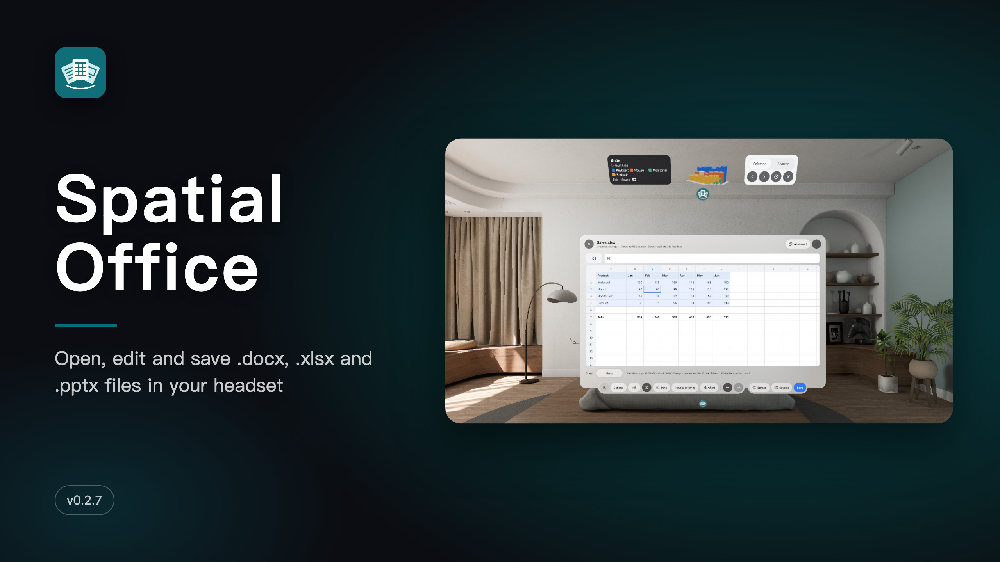

| | |
|---|---|
|  | 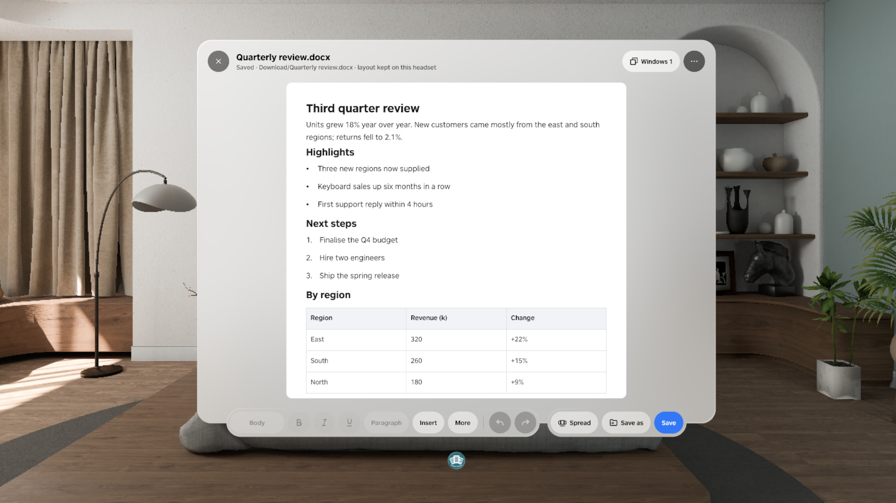 |
| 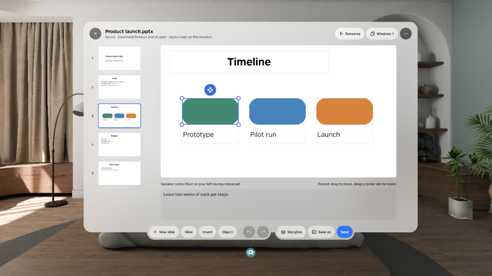 | 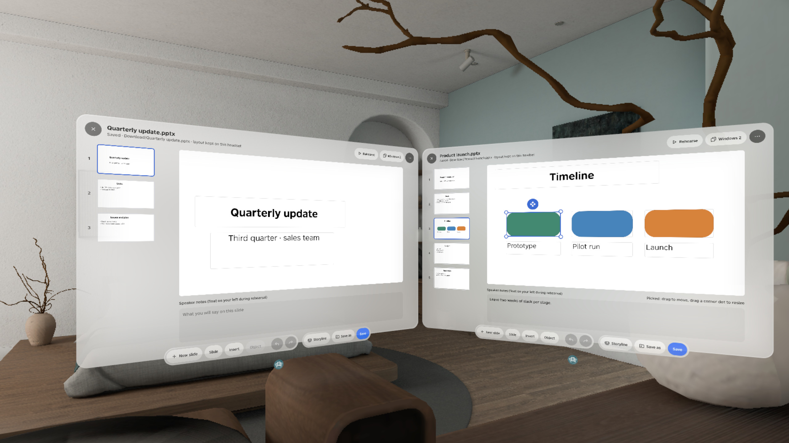 |
| 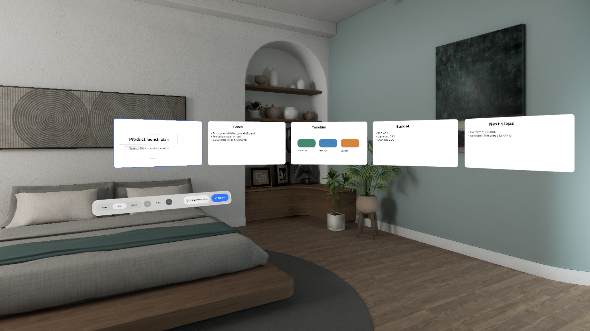 |  |

Screenshots: PICO emulator, v0.2.7, driven by debug commands, **not a real hand-gesture recording**. The demo video is also debug-driven and has no sound.

## What it does

- **Documents**: headings / body / lists, alignment, strikethrough, pictures, tables, find and replace, word count
- **Spreadsheets**: 45 common functions, number and date formats, fill colours, sort and filter, freeze top row, insert / delete rows and columns, bar / line / pie charts
- **Slides**: new slide (title / body / two columns / blank), text boxes, shapes, pictures, tables, colour themes, drag to reorder; what you insert is picked with a click, moved by dragging and resized by its corner dots
- **Several files at once**: one window per file; Windows n in the title bar switches, goes Home or sets them side by side
- **3D chart**: select data, Chart › 3D chart; the chart floats above the sheet window and follows every edit; columns or scatter, turn left / right
- **Spread / rehearse**: lay a deck out in a row, an arc or layers; rehearsal shows a big slide, notes and a timer
- **Saving**: the first save backs up the original; Save as a copy / PDF / CSV / TXT / PNG per slide
- Ray, gaze + pinch, keyboard and mouse; Chinese and English

## Install

```
adb install -r SpatialOffice-v0.2.7.apk
pico-cli app launch io.embodit.spatialoffice
```

The APK on the Release is the **unsigned** `assembleRelease` build (for platform-managed signing). To sideload it, sign it yourself first, or build a debug APK with `./gradlew :app:assembleDebug`. Build notes and the debug broadcast are in [AGENTS.md](AGENTS.md).

## Several files at once, moving what you insert (v0.2.5)

Every open file has its own window; opening a second document, sheet or deck never replaces the first. A new window opens in front and the system puts the earlier ones behind it, so the title bar has **Windows n**: switch to another file, go Home, or set the windows out **Side by side**. Text boxes, pictures, shapes and tables on a slide are picked with a click, moved by dragging and resized by the dots on their corners; pictures and tables in a document resize the same way.

## Cloud drives

Feishu, Google Drive, OneDrive and Dropbox are optional; every local file works without an account. **A service appears in the app only when its client id was put in at build time** (`-Pcloud.feishu.appId=…` on the gradle command line, or the same key in `local.properties`, which is not in git). Without one the service is not mentioned anywhere (no Accounts page, no Browse location, no cloud group in Recent, no cloud row in Save as) and no request is sent; this release ships with none. Save as offers "Save a copy to <drive>" only while a drive is signed in. With one, **Connect opens the system browser** on the service's own sign-in page (authorisation code + PKCE) and comes back through the registered callback. Where to register, redirect URIs, scopes and keys are in the Chinese table above.

## Known issues (v0.2.7)

- This release contains no cloud client ids, so Accounts & drives does not appear; sign-in, browsing and saving with real cloud accounts are **not verified** (unit tests check the request and response formats only)
- With several files open, a new window opens in front and the system hides the one underneath. The system has no staggered placement (an overlapping window is not shown; a window beside another is mostly out of view). Switch under Windows n in the title bar, or choose Side by side there
- The 3D chart belongs to the sheet it was opened from; it is put away when another sheet comes to the front
- Moving and resizing was checked with a real pointer drag on the emulator; hand, controller ray and gaze + pinch have not been checked one by one on the headset
- On a loaded emulator the 3D chart takes 1 to 3 s to open, with one frame of about 0.3 to 0.5 s as it appears (since v0.2.4 it no longer freezes or shows "not responding"; not measured on an idle machine)
- The slides window keeping the notes area for any page proportion (v0.2.6) was checked on the emulator with 4:3, 16:9, 16:10 and tall files, not yet on the headset
- With the Chinese IME, tap a sheet cell once before typing
- The demo video has no sound and is driven by debug commands, not real hand gestures
